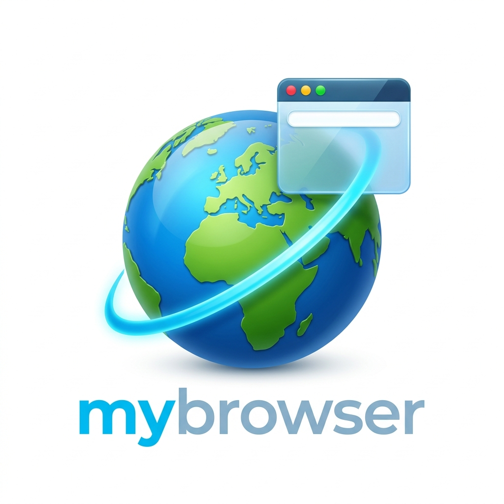

<div align="center">



# MyBrowser

**A fast, private, and beautiful custom desktop browser — built for everyone.**

[](https://github.com/Kanduriavinash/mybrowser/releases/latest)
[](https://github.com/Kanduriavinash/mybrowser/releases/latest)
[](LICENSE)
[](https://www.electronjs.org/)

</div>

---

## ⬇️ Download & Install

> **No setup needed. Just download, install, and browse.**

<div align="center">

### 👉 [**Download MyBrowser Installer (`MyBrowser-Setup-1.1.0.exe`)**](https://github.com/Kanduriavinash/mybrowser/releases/latest/download/MyBrowser-Setup-1.1.0.exe) 👈

[**Download Portable Version (`MyBrowser-Portable-1.1.0.exe`)**](https://github.com/Kanduriavinash/mybrowser/releases/latest/download/MyBrowser-Portable-1.1.0.exe) · [**View All Releases**](https://github.com/Kanduriavinash/mybrowser/releases/latest)

</div>

**How to install:**
1. Click **Download MyBrowser Installer** above (or pick Portable if you don't want to install)
2. Run **`MyBrowser-Setup-1.1.0.exe`** (if Windows SmartScreen appears, click **More info → Run anyway** since the app is open-source and unsigned)
3. MyBrowser appears on your **Desktop** and **Start Menu** — open it and start browsing! 🎉

> ✅ **Auto-updates built in** — MyBrowser will silently download and apply new versions in the background. You'll never need to manually update.

---

## ✨ Features

| Feature | Description |
|---|---|
| 🗂️ **Power Tabs & Vertical Rail** | Horizontal or collapsible vertical tabs, Pin tabs, color Groups, Mute audio, Hover previews, Reopen closed tab (`Ctrl+Shift+T`), Session Restore |
| 🪟 **Split View & Side Panels** | View two tabs side-by-side with a resizable divider, plus Slide-out Side Panels (Notes, Calculator, Search, Wiki, Custom Web Panel) |
| 🔍 **Omnibox & Command Palette** | Address-bar autocomplete from tabs/bookmarks/history + fuzzy Command Palette (`Ctrl+K`) |
| 📖 **Reader Mode & Find in Page** | Distraction-free Dark/Sepia/Light Reader Mode (`Alt+R`) and live Find-in-Page (`Ctrl+F`) with match counter |
| ⬇️ **Downloads Manager** | Track progress, Pause/Resume/Cancel, Open file, or Show in Folder (`Ctrl+J`) |
| 🕵️ **Private / Incognito Windows** | Isolated session windows (`Ctrl+Shift+N`) that leave zero history or cookies |
| 🛡️ **Privacy Shield & Ad Blocker** | Blocks 50+ ad networks, per-site Shield allowlist, URL tracking parameter stripping (`utm_*`, `fbclid`, `gclid`), and HTTPS-Only mode |
| 📸 **Media & Productivity** | One-click Page Screenshot (copies to clipboard & saves PNG), Picture-in-Picture (`PiP`), and per-tab Zoom (`Ctrl +/-/0`) |
| 🌙 **New Tab & Right Controls** | Live clock/greeting, customizable Quick Links, and right-aligned Windows window controls (`—`, `□`, `✕`) |

---

## 🖼️ Screenshot

> *(Screenshots coming soon — contributors welcome!)*

---

## ⌨️ Keyboard Shortcuts

| Shortcut | Action |
|---|---|
| `Ctrl + T` / `Ctrl + W` | Open new tab / Close current tab |
| `Ctrl + Shift + T` | Reopen recently closed tab |
| `Ctrl + Shift + N` | Open Private / Incognito window |
| `Ctrl + K` | Open Command Palette |
| `Ctrl + F` | Find in page |
| `Ctrl + J` | Open Downloads manager |
| `Ctrl + L` | Focus address bar & Omnibox |
| `Ctrl + D` / `Ctrl + B` | Bookmark page / Open Bookmarks sidebar |
| `Ctrl + H` | Open History sidebar |
| `Ctrl + Shift + V` | Toggle Vertical Tabs |
| `Alt + S` / `Alt + R` | Toggle Split View / Reader Mode |
| `Ctrl + Shift + S` | Capture screenshot |
| `Ctrl + +` / `-` / `0` | Zoom in / Zoom out / Reset zoom |
| `Ctrl + Tab` / `Ctrl + 1–9` | Switch tabs |
| `F5` / `Escape` | Reload / Close active overlay or stop |

---

## 🛡️ Ad Blocker

MyBrowser blocks **50+ ad and tracker domains** out of the box — no extensions needed:

- Google Ads, DoubleClick, Facebook Ads
- Taboola, Outbrain, Criteo, Rubicon
- Analytics trackers (Hotjar, Mixpanel, Amplitude, Segment…)
- And many more

Open the **Shield icon** in the toolbar to see real-time stats of what's being blocked.

---

## 🔧 Build from Source

### Prerequisites
- [Node.js](https://nodejs.org/) v18+
- [Git](https://git-scm.com/)

```bash
# Clone the repository
git clone https://github.com/Kanduriavinash/mybrowser.git
cd mybrowser

# Install dependencies
npm install

# Run in development mode
npm start

# Build a Windows installer
npm run build
```

The installer will be output to the `dist/` folder.

---

## 📁 Project Structure

```
mybrowser/
├── main.js          # Electron main process (windows, IPC, downloads, privacy shield)
├── preload.js       # Secure context bridge between main & renderer
├── src/
│   ├── browser.html # App UI structure
│   ├── browser.js   # Core renderer (tabs, split view, bookmarks, history, settings)
│   ├── features.js  # Power features (downloads, find, reader, command palette, omnibox)
│   └── browser.css  # Dark UI design system
├── assets/
│   └── icons/       # App icons
└── package.json     # Build configuration (electron-builder)
```

---

## 🤝 Contributing

Pull requests are welcome! For major changes, please open an issue first.

1. Fork the repo
2. Create your feature branch (`git checkout -b feature/my-feature`)
3. Commit your changes (`git commit -m 'Add my feature'`)
4. Push to the branch (`git push origin feature/my-feature`)
5. Open a Pull Request

---

## 📄 License

MIT © [Kanduriavinash](https://github.com/Kanduriavinash)

---

<div align="center">

Made with ❤️ using [Electron](https://www.electronjs.org/)

⭐ **If you like MyBrowser, please give it a star!** ⭐

</div>
